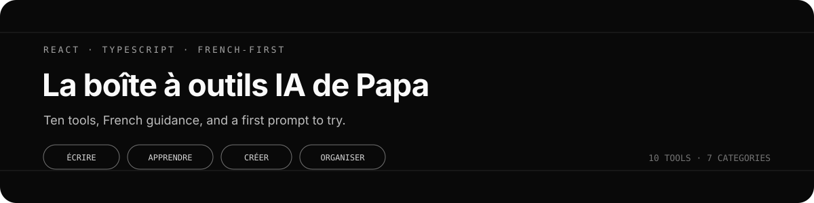

<p align="center">
  
</p>

[](https://github.com/MerveilleDivine/papa-ai-toolbox/actions/workflows/build.yml)

# La boîte à outils IA de Papa

I built this for my father, who wanted to try AI tools but needed somewhere to start. It is a French-language guide to 10 tools, with an example prompt, a practical tip, and a caution for each one.

Users can search by task, filter by category, open a tool's guide, copy a starter prompt, and save favourites without creating an account.

## Engineering decisions

- Search: accent-insensitive matching across tool names, descriptions, categories, prompts, and guidance. Searching `ecrire` also matches `écrire`.
- URL state: search and category filters stay in the address, so a filtered selection can be bookmarked or shared. Favourites themselves stay in the browser.
- Persistence: stored favourites are validated against known tool IDs and deduplicated. The hook migrates the original storage key, handles unavailable storage, and synchronizes changes and resets across tabs.
- Catalogue: typed local data keeps each tool's guidance in one place. There is no application server, account system, database, or call to an AI provider.
- Accessibility: labelled controls, favourite and guide states, result announcements, and recovery links for unknown tool pages.

## Run locally

Use Node.js 22.12 or newer.

```bash
git clone https://github.com/MerveilleDivine/papa-ai-toolbox.git
cd papa-ai-toolbox
npm ci
npm run dev
```

Open the URL printed by Vite. For a production build and local preview:

```bash
npm run build
npm run preview
```

## Verify

```bash
npm run lint
npm test
npm run build
```

GitHub Actions runs the same checks on pushes and pull requests to `main`. Tests cover search, URL filters, favourites, cross-tab storage events, copying prompts, and detail routes. They use local data and do not need API keys.

## Code map

| File | Responsibility |
| --- | --- |
| `src/data/tools.ts` | Typed catalogue and French guidance |
| `src/lib/toolFilters.ts` | Search normalization and filter composition |
| `src/hooks/useFavorites.ts` | Storage validation, migration, and tab synchronization |
| `src/pages/Home.tsx` | Search, filters, favourites, and results |
| `src/pages/ToolDetails.tsx` | Individual guides and unknown-tool recovery |
| `src/components/PromptCopyButton.tsx` | Clipboard feedback and fallback |

## Limits

This is a frontend project. The catalogue is edited in source, favourites do not sync between devices, and external tools control their own availability and pricing. There is no hosted demo linked here while deployment is unconfigured.

The most useful next additions are a catalogue link check and browser tests for the complete search-to-guide flow.

React 19 · TypeScript · Vite 7 · Tailwind CSS 4 · React Router · Vitest · Testing Library

Built by [Mervine Muganguzi](https://www.mervine.dev). [More projects](https://github.com/MerveilleDivine).
